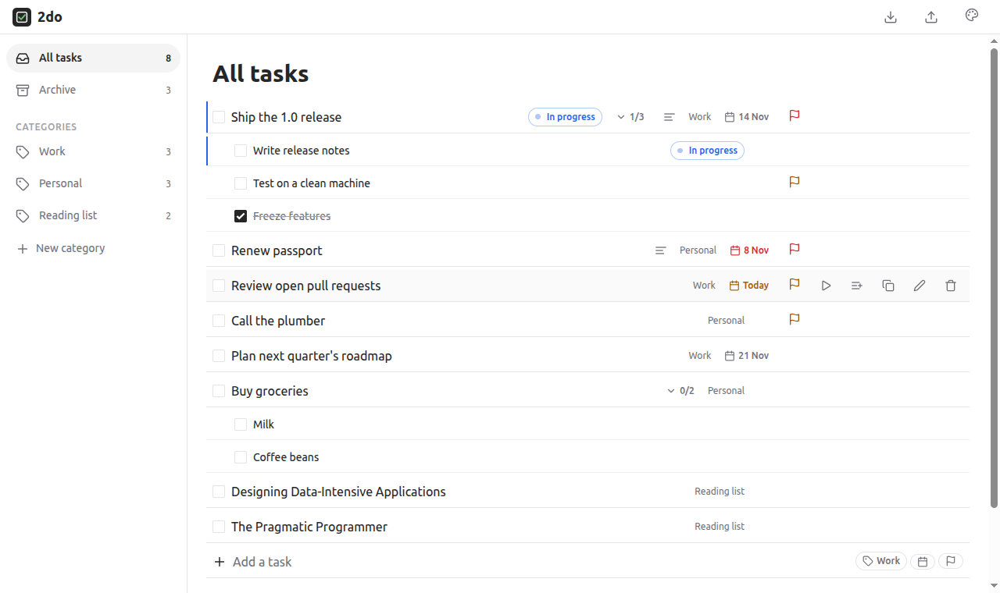
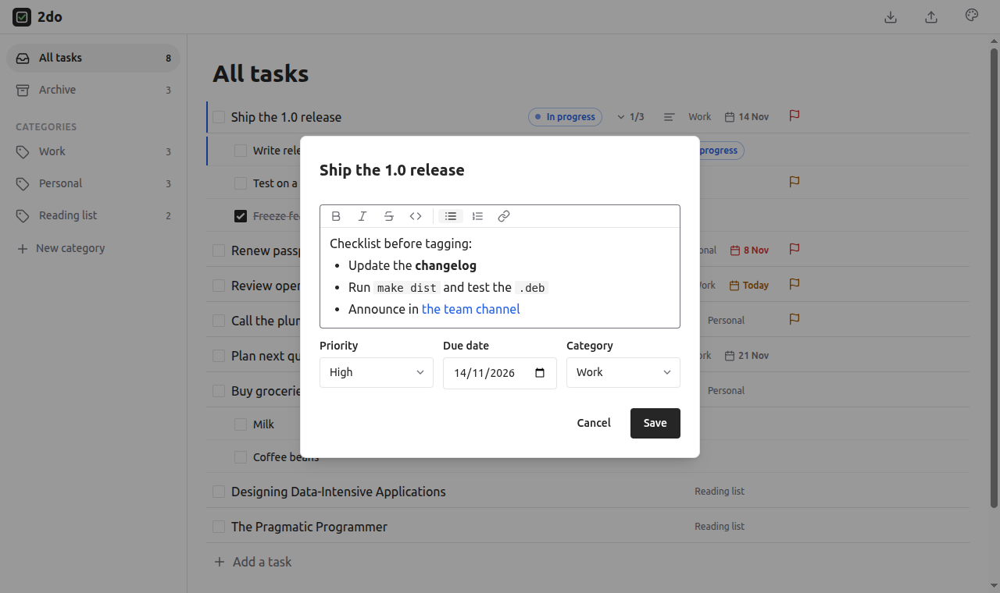
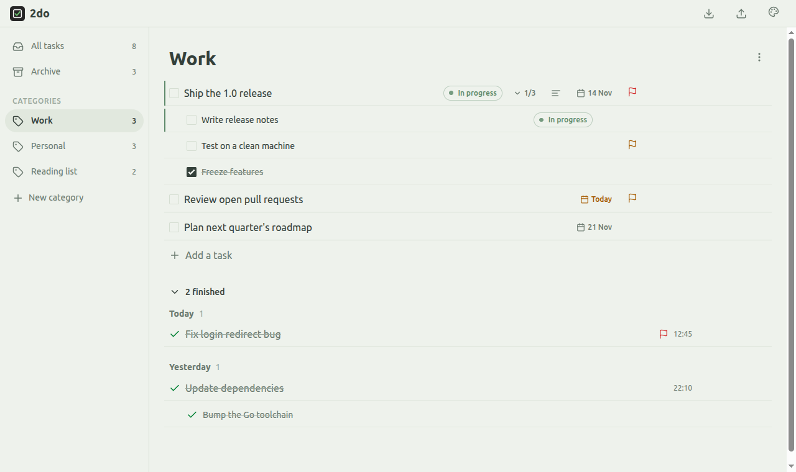
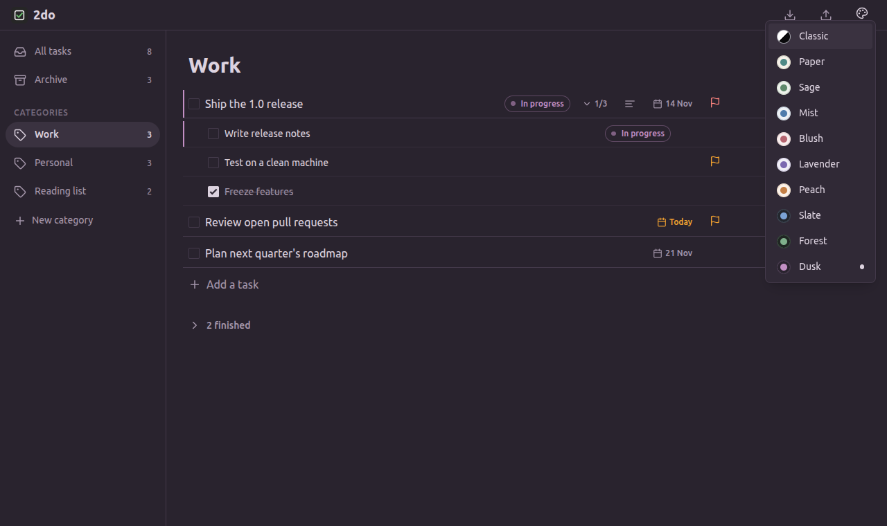

# 2do

A simple, offline-first todo app. Plain HTML/CSS/JS with no frontend framework, styled with [Oat UI](https://oat.ink).
It runs as a Linux desktop app or as an installable PWA.



- Categories: create as many as you need (Personal, Project X, …)
- Priorities (high, medium, low) and due dates
- Subtasks, nested as deep as you like
- Mark tasks you've started as **In progress**
- Finished tasks move to the Archive, grouped by the day they were finished. You can reopen them
- Notes with basic formatting: bold, italic, code, lists and links
- Copy a task or a whole category as Markdown
- 10 soft color themes, light and dark
- Import and export everything as a Markdown (`.md`) file ([format](#import-file-format-md))

| Notes editor | Finished tasks inline (Sage theme) | Color themes (Dusk theme) |
|---|---|---|
|  |  |  |

## Install

Download the file for your system from the project's **Releases** page. If you're not sure which one you need, run
`uname -m`: `x86_64` means **amd64** and `aarch64` means **arm64**.

### Ubuntu, Debian, Linux Mint, Pop!_OS and other Debian-based distros

Download `2do_<version>_amd64.deb`, then double-click it. It opens in your Software or App Center app; click
**Install**. You can also install it from a terminal:

```sh
sudo apt install ./2do_0.2.1_amd64.deb
```

- **Update:** install the newer `.deb` the same way.
- **Uninstall:** remove it from the Software app, or run `sudo apt remove 2do`.

### Fedora, Arch, openSUSE and any other distro

Download `2do-linux-amd64`, then run these from the folder you downloaded it to:

```sh
chmod +x 2do-linux-amd64
./2do-linux-amd64 install
```

This installs 2do for your user only, without root. It puts the program in `~/.local/bin/2do`, adds an app menu
entry and icon, and doesn't change anything else on your system. You can delete the downloaded file afterwards.

- **Update:** download the newer file and run `install` again.
- **Uninstall:** run `2do uninstall`.

### Check the download (optional)

Each release includes a `SHA256SUMS` file. Put it in the same folder as your download, then run:

```sh
sha256sum -c SHA256SUMS --ignore-missing
```

It should print `OK` next to your file.

## Start 2do

Open your app menu and search for **2do**, or run `2do` in a terminal. Closing the window quits the app.

2do opens in its own window if a Chromium-based browser is installed (Chrome, Chromium, Brave, Edge or Vivaldi).
Without one, it opens in your default browser. The program itself is a single static file with no other
dependencies, so it doesn't need GTK, WebKit or Node.

## Your data

Your tasks are saved in `~/.local/share/2do/data.json`. Uninstalling never deletes this file, and you can back it up
like any other file. To delete your data completely, remove `~/.local/share/2do` and `~/.config/2do` (the app
window's browser profile).

**Moving to another computer.** Install 2do there, then use either of these:

- **Markdown:** on the old computer, click the export icon (top right) to save a `.md` file. On the new one, click the
  import icon, pick that file and choose **Replace**.
- **Data file:** close 2do on both computers, then copy `~/.local/share/2do/data.json` to the same place on the new
  one. This keeps everything exactly, including the archive history.

There is no built-in sync. If you keep `data.json` in a synced folder (for example with Syncthing or Nextcloud,
through a symlink), only run 2do on one computer at a time. Otherwise the last one to save overwrites the other's
changes.

**PWA (browser-only) use.** The `web/` folder is a self-contained static site. Serve it over HTTPS from any static
host your organisation approves, open it in Chrome or Edge, and choose **Install app** in the address bar. It then
works offline. In this mode, your tasks are stored in that browser's local storage, separate from the desktop app's
data file, so export to `.md` now and then as a backup.

## How to use

**Adding tasks.** Open a category (or **All tasks**), type in **Add a task** below the list and press **Enter**. The
input stays focused, so you can type the next task right away. While you type, small chips appear on the right for
optional settings:

- the calendar chip sets a due date
- the flag chip sets the priority (low by default)
- the tag chip, in **All tasks** only, picks the category

Press **Esc** to clear the input.

**Working with tasks.** Hover over a task to see its controls.

| Action | How |
|---|---|
| Rename | Click the title, edit it, then press Enter (or Esc to cancel) |
| Mark as in progress | Click the ▶ icon. The task gets a blue **In progress** chip and moves to the top of its list. Click ⏸ to stop. Hover over the chip to see when you started |
| Change priority | Click the flag. Red is high, amber is medium, and low shows no flag |
| Change due date | Click the date (or the calendar icon) to open the task dialog with the date selected. Overdue dates turn red and today's turn amber |
| Notes, or move to another category | Pencil icon. Notes have a small formatting toolbar: bold, italic, strikethrough, code, bulleted and numbered lists, and links. Shortcuts: Ctrl+B, Ctrl+I, Ctrl+K for a link, Tab / Shift+Tab to indent a list item. Ctrl+click a link to open it. Pasted text comes in unformatted |
| Copy | Two-squares icon. Copies the task and all its subtasks as a Markdown checklist, ready to paste into notes or chat, or to import elsewhere (see [Import file format](#import-file-format-md)). Also works in the Archive |
| Delete | Trash icon |

Tasks are sorted with in-progress tasks first, then by priority, then by due date. `` `Backticks` `` in a title are shown as inline code.

**Subtasks.** Hover over a task and click the add-subtask icon (lines with a +). Type the subtask and press Enter. The
input stays open, so you can add several in a row. Press Esc when you're done.

| Action | How |
|---|---|
| Collapse or expand subtasks | Click the `2/5` progress chip next to the parent task |
| Make a task a subtask of the one above it | Click its title to rename it, then press **Tab** |
| Move a subtask up a level | Click its title, then press **Shift+Tab** |
| Finish a subtask | Tick it. It moves below its parent's open subtasks, struck through, and the progress chip updates. Once more than two are finished, they fold into a stack of cards showing the latest one |
| See finished subtasks | Click the stack to expand it. Click **Show less** (in the same spot) to fold it again |
| Reopen a subtask | Untick it. This also reopens its parent if the parent was finished |

Subtasks always belong to their top-level task's category. Moving a task to another category moves its subtasks too.

**Finishing and reopening.** Tick the checkbox to finish a task. A top-level task moves to the **Archive** together
with its subtasks, and any open subtasks are finished with it. The snackbar offers
**Undo**. The archive groups tasks by the day you finished them (Today, Yesterday, then dates). Hover over a title to
see the exact finish, creation and due times. Use the reopen icon to bring a task back. Click **N finished** under a
list to show its finished tasks right there, grouped the same way; click it again to hide them.

**Categories.** Type a name in **New category** in the sidebar and press Enter. To rename or delete a category, open
it and use the ⋮ menu. Deleting a category also deletes its tasks. The same menu has **Copy as Markdown**, which
copies the category's open tasks and their subtasks under a `## Category` heading. Finished tasks in the Archive are
left out.

**Color theme.** Click the palette icon at the top right and pick one of 10 themes: Classic (follows your
system's light or dark mode), Paper, Sage, Mist, Blush, Lavender and Peach (light), or Slate, Forest and Dusk (dark).
The choice is remembered on this computer; it isn't part of your exported tasks.

**Import and export.** These are the two icons at the top right: the arrow pointing down into a tray imports a `.md` file, and the arrow pointing up out of a tray exports one. Hover over either to see its label.

## Import file format (.md)

2do imports and exports plain Markdown, so you can write an import file by hand in any text editor. It's also the
format 2do uses when you export. To try it, import [`examples/import-sample.md`](examples/import-sample.md).

### Quick example

```md
## Personal

- [ ] Renew passport `priority:high` `due:2026-12-01`
  > Book an appointment first.
- [ ] Buy groceries
- [x] Pay electricity bill `done:2026-11-03T10:30:00.000Z`

## Project Alpha

- [ ] Write the design doc `priority:high` `due:2026-11-15`
  - [ ] Outline the API
  - [x] Collect requirements
- Review open pull requests
```

This creates two categories, **Personal** and **Project Alpha**. Project Alpha's design doc task gets two subtasks.
The finished `[x]` top-level task goes straight to the archive; the finished subtask stays under its parent.

### Rules

| Line | Meaning |
|---|---|
| `## Name` | Starts a category called *Name*. A repeated heading continues the same category, ignoring case. Tasks that appear before the first `##` heading go into a category called **Imported**. |
| `- [ ] Title` | An open task. `*` and `+` bullets work too. |
| `- [x] Title` | A finished task, which goes to the archive. `[X]` works too. |
| `- [/] Title` | An in-progress task (the convention used by Obsidian and other apps). 2do exports these as `- [ ]` with a `started` tag instead, so the file still renders as a normal checklist elsewhere. |
| `- Title` | A plain bullet without a checkbox is imported as an open task. |
| `  - [ ] Title` | A subtask of the task above it with less indentation. Indent each level by two spaces (or a tab); nest as deep as you like. |
| `  > Some text` | A note for the task above it. Indent it by at least two spaces. Each `>` line is one line of the note. Notes can use `**bold**`, `*italic*`, `~~strikethrough~~`, `` `code` ``, `- ` and `1. ` lists (indent two spaces to nest) and `[links](https://example.com)`. |
| Anything else | Ignored. This includes `#` and `###` headings, paragraphs and blank lines. |

See [`examples/tasks-1.md`](examples/tasks-1.md) for a real-world file with subtasks nested three levels deep.

### Optional metadata

To set metadata, add it at the **end** of the task line, as `` `key:value` `` in backticks, separated by spaces, in
any order:

| Key | Values | If missing or invalid |
|---|---|---|
| `priority` | `high`, `medium` or `low` | `low` |
| `due` | Date as `YYYY-MM-DD`, for example `2026-12-01` | No due date |
| `started` | When you started the task, as an ISO date-time. Marks the task as in progress | Not in progress (unless the line uses `[/]`) |
| `done` | When the task was finished, as an ISO date-time such as `2026-11-03T10:30:00.000Z`. Only used on `[x]` tasks, and it decides which day the task appears under in the archive. | The time of the import |
| `created` | When the task was created, as an ISO date-time | The time of the import |

### Merge or Replace

After you pick a file, 2do shows how many tasks and categories it found and asks what to do:

- **Merge** adds the tasks to your existing data. Categories with the same name (ignoring case) are combined, and a
  task is skipped if the same category already has a task with the same title, parent and done state. Subtasks of a
  skipped task are merged under the existing one. Importing the same file
  twice doesn't create duplicates.
- **Replace** deletes all your current categories and tasks, then loads the file.

If you're not sure which to choose, export first so you have a backup.

## Command-line options

```
2do install         # install for your user (app menu entry, no root)
2do uninstall       # remove the installed app; your tasks are kept
2do -port 47823     # localhost port (default 47823)
2do -no-window      # only run the server; open http://127.0.0.1:47823 yourself
2do -version        # print the version
```

If you start 2do while it's already running, it opens another window to the running instance.

## Troubleshooting

- **It opens in a normal browser tab:** no Chromium-based browser was found on your `PATH`. Flatpak-only browsers
  aren't detected. Install one natively, or keep using the tab. In that case, press Ctrl+C in the terminal to quit.
- **"error listening on 127.0.0.1:47823":** another program is using that port. Run `2do -port 47900` (or any free
  port). Your data is unaffected because it lives in the data file, not in the browser.
- **Changes don't show after upgrading:** close every 2do window so the old version stops, then start 2do again. If
  it still looks old, reload the window with Ctrl+Shift+R.
- **2do doesn't appear in the app menu right after installing:** log out and back in. Some desktops only re-read the
  menu at login.

## Building from source

You need [Go](https://go.dev/dl/) 1.24 or newer, and `make`.

| Command | What it does |
|---|---|
| `make run` | Build and start 2do |
| `make install` | Build and install for your user (same as `2do install`) |
| `make uninstall` | Remove the installed copy (same as `2do uninstall`) |
| `make dist` | Build the release files in `dist/` |

`make dist` builds, for both amd64 and arm64:

- `2do-linux-<arch>`, the self-installing binary
- `2do_<version>_<arch>.deb`, the Debian package (needs `dpkg-deb`, which Debian-based distros already have)
- `SHA256SUMS`

Set the version with `make dist VERSION=0.2.1`. The package's maintainer field comes from your `git config` name and
email; override it with `MAINTAINER="Your Name <you@example.com>"`.

To publish a release, upload everything in `dist/` to a new release on the repository's Releases page, for example
with GitHub CLI: `gh release create v0.2.1 dist/*`.

The web app in `web/` is embedded into the binary when it's built, so rebuild (`make run`) after changing any file
there.

## Security notes

The local server only listens on `127.0.0.1`. It rejects requests with an unexpected `Host` header (DNS rebinding) and
writes that lack a custom header (CSRF from other websites). The data file is created with `0600` permissions.
